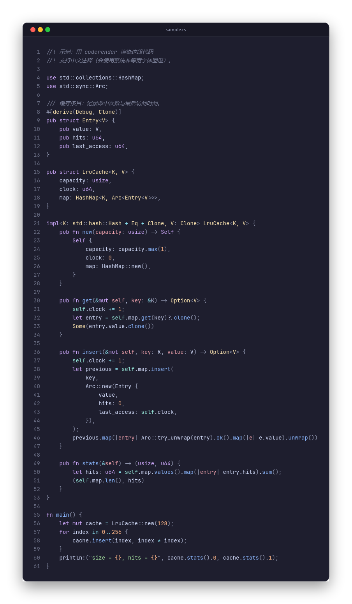

# coderender

把代码渲染成一张漂亮的图片：**主题包**（代码配色 + 窗口装饰）、**代码高亮扩展包**、
**参数拼错提示**、**任意倍率矢量渲染**、**内置 Nerd Font**。

```bash
coderender render src/main.rs -o main.png --theme mocha --window macos --scale 2
coderender pack new my-syntax --kind syntax      # 给自己家的语言写高亮规则
coderender pack install my-syntax                # 装上就能用
```



---

## 特性

- **主题包**：一个 TOML 文件同时包含多套代码配色预设与多套窗口装饰预设。
  内置 Catppuccin 主题包，含 [Latte / Frappé / Macchiato / Mocha](https://catppuccin.com/palette/)
  四套配色（各自带背景色），以及 macOS 红绿灯、Windows 11 两种窗口装饰。
  无参时默认 **Catppuccin Mocha + macOS 红绿灯**。
- **代码高亮扩展包**：syntect 默认语法集之外的语言，可以用
  [Sublime Syntax](https://www.sublimetext.com/docs/syntax.html) 自己写规则并装成扩展包；
  内置语法集本身也以扩展包形式提供，可导出、可被覆盖。
- **拼错提示**：`--theme` / `--window` / `--font-mono` / `--lang` / 包 ID 没有严格命中时，
  报错退出并给出「您是否指的是……」（归一化 + 编辑距离 + 前缀/包含加权）。
- **大段代码**：整段文本只整形一次、逐字形复用栅格缓存、整数混合写像素，
  1200 行代码 1x 约 0.7s（详见[性能](#性能设计)）。
- **清晰度倍率**：1x 是刚好容纳输入的尺寸；2x/3x/4x 重新按矢量栅格化（不是位图放大），
  输出宽高严格是 1x 的整数倍。
- **字体**：内置 JetBrainsMono Nerd Font（Regular/Bold/Italic，OFL 许可），
  代码默认使用它；中文等字符自动回退到系统非等宽字体；也可以手动指定任意已安装字体。
- **扩展包管理**：开发目录 ↔ `.crpack` 分发包双向互通，
  `pack install / uninstall / list / new / build` 一条龙。
- **纯 Rust**：cosmic-text（整形 + 系统字体）、syntect（语法高亮）、tiny-skia（矢量绘制）、
  image（PNG 编码），无需 fontconfig / oniguruma。

## 构建与安装

需要 Rust 1.89+（`rustup` 安装好即可）。

```bash
cargo build --release
# 产物：target/release/coderender(.exe)
cargo install --path .   # 可选：安装到 ~/.cargo/bin
```

## 快速开始

```bash
# 默认：Mocha 配色 + macOS 红绿灯 + 行号 + 阴影
coderender render samples/sample.rs -o out.png

# 换配色 / 换窗口装饰 / 2 倍清晰度
coderender render samples/sample.rs -o out.png --theme latte --window windows --scale 2

# 从标准输入读取、显式指定语言、无行号
cat foo.py | coderender render --lang python -o foo.png --no-line-numbers

# 看看有哪些预设 / 有哪些等宽字体 / 装了哪些扩展包
coderender themes
coderender fonts                    # 只列等宽字体
coderender fonts --all --filter mono
coderender pack list --verbose
```

## 命令行

### `coderender render [INPUT]`

| 参数 | 说明 |
| --- | --- |
| `INPUT` | 输入文件；省略或 `-` 时从标准输入读取 |
| `-o, --output <PATH>` | 输出 PNG；`-` 写到标准输出。默认 `<文件名>.png` |
| `-t, --theme <ID>` | 配色预设，默认 `mocha` |
| `--theme-pack <PATH>` | 额外加载一个主题包（目录或 TOML） |
| `-w, --window <ID>` | 窗口装饰，默认 `macos` |
| `--syntax-pack <PATH>` | 额外加载一个代码高亮扩展包（目录或 `.crpack`） |
| `--no-user-packs` | 不加载已安装的扩展包（只用 `--syntax-pack` 与内置规则） |
| `-s, --scale <N>` | 清晰度倍率，1–4，默认 1 |
| `--font-mono <NAME>` | 代码等宽字体（系统已安装，或内置 JetBrainsMono Nerd Font） |
| `--font-fallback <NAME>` | 非等宽回退字体（用于中文等字符与标题栏文字） |
| `--font-size <PX>` | 字号，默认 14 |
| `--line-height <MULT>` | 行高倍数，默认 1.55 |
| `--padding <PX>` | 代码区内边距，默认取窗口装饰预设（28） |
| `--tab-width <N>` | Tab 展开宽度，默认 4 |
| `--no-line-numbers` | 不显示行号 |
| `--no-shadow` | 不绘制窗口阴影 |
| `--canvas <COLOR>` | 画布底色，默认透明（`#rrggbb[aa]`） |
| `--title <TEXT>` | 标题栏文字，默认文件名 |
| `--lang <LANG>` | 强制语法（`rust` / `python` / `json` …） |
| `--png-compression <fast\|default\|best>` | PNG 压缩级别，默认 `fast` |
| `-v, --verbose` | 打印各阶段耗时、字体与预设信息 |

### `coderender themes`

列出主题包中的配色与窗口装饰；`--export <PATH>` 把内置包导出成可修改的 TOML 模板。

### `coderender fonts`

列出字体族（默认只列等宽字体），`--all` 列出全部，`--filter` 过滤，
`--license` 打印内置字体的 SIL Open Font License 1.1 原文。

### `coderender pack`

| 子命令 | 说明 |
| --- | --- |
| `pack list [--kind theme\|syntax] [-v]` | 列出已安装的扩展包；`-v` 列出包内配色/语法明细 |
| `pack install <目录\|*.crpack>...` | 安装扩展包（可一次多个） |
| `pack uninstall <ID> [--kind ...]` | 卸载扩展包（ID/名称，省略 `--kind` 时自动判断） |
| `pack new <名称> [--kind theme\|syntax] [-o 目录]` | 生成扩展包开发模板 |
| `pack build <目录> [-o 文件]` | 把开发目录打包成 `.crpack` 分发包 |
| `pack builtin-export [-o 目录]` | 把内置代码高亮规则导出成一个扩展包 |

安装位置（可用环境变量 `CODERENDER_HOME` 覆盖，测试时很有用）：

```text
%APPDATA%/coderender/packs/themes/<id>/       # Windows
~/Library/Application Support/coderender/...  # macOS
~/.local/share/coderender/packs/...           # Linux
```

## 主题包

主题包是纯 TOML，内置包在 [`assets/themes/catppuccin.toml`](assets/themes/catppuccin.toml)。
`coderender themes --export my-pack.toml` 可以导出后修改：

```toml
[pack]
id = "my-pack"
kind = "theme"              # theme | syntax（不写则按内容推断）
name = "My Pack"
version = "1.0.0"
license = "MIT"

# 代码配色预设（各自带背景色）
[palettes.night]
appearance = "dark"        # dark | light
background = "#1e1e2e"     # 代码背景
titlebar   = "#181825"     # 标题栏（省略则从背景色推导）
border     = "#313244"     # 窗口描边（省略则从背景/前景推导）
foreground = "#cdd6f4"
gutter     = "#6c7086"     # 行号

[palettes.night.syntax]    # 语法着色；未给出的类别回退到 foreground
keyword = "#cba6f7"
function = "#89b4fa"
type = "#f9e2af"
string = "#a6e3a1"
number = "#fab387"
comment = "#7f849c"
# builtin / constant / operator / punctuation / variable / parameter /
# property / attribute / tag / escape / invalid 均可覆盖

# 窗口装饰预设
[decorations.mac]
title_height = 36          # 0 表示无标题栏
corner_radius = 12
title_align = "center"     # left | center
titlebar_style = "solid"   # solid = 用 palette.titlebar；tint = 背景向文字色混 4.5%
title_font_scale = 0.82
padding = 28

[decorations.mac.shadow]
offset_y = 14
blur = 30
alpha = 0.42

[decorations.mac.controls]
style = "traffic_lights"   # traffic_lights | windows | none
radius = 6.5
spacing = 19
inset = 20
close = "#ff5f57"
minimize = "#febc2e"
maximize = "#28c840"
```

窗口装饰 `style = "windows"` 时使用 `icon_size` / `button_width` / `inset`。

配色 ID 与窗口装饰 ID 都支持忽略大小写、空格和重音符号的匹配：
`--theme Frappé`、`--window "Windows 11"` 都能命中；拼错时会提示相近的 ID。

## 代码高亮扩展包

一个扩展包是一个「开发文件夹」：`pack.toml` + `syntaxes/` 里的 Sublime Syntax 文件。

```text
my-syntax-pack/
  pack.toml
  syntaxes/
    Zig.sublime-syntax
    Gleam.sublime-syntax
```

`pack.toml`：

```toml
[pack]
id = "zig-extra"
kind = "syntax"
name = "Zig & Gleam"
version = "1.0.0"
license = "MIT"

# 可选：显式声明要加载的语法文件；省略则自动扫描 syntaxes/ 下的 *.sublime-syntax
[[syntax]]
path = "syntaxes/Zig.sublime-syntax"
extensions = ["zig", "zon"]   # 可选：补充语法文件里没声明的扩展名
names = ["Zig"]               # 可选：补充 --lang 可用的名字
```

开发流程：

```bash
coderender pack new zig-extra --kind syntax      # 生成模板（含一个最小语法示例）
$EDITOR zig-extra/syntaxes/MyLang.sublime-syntax
coderender pack install zig-extra                # 安装后立即可用
coderender render foo.zig -o foo.png             # .zig 直接命中扩展包
coderender render foo.txt -o foo.png --lang Zig  # 或手动指定语法
coderender pack build zig-extra                  # 打包成 zig-extra-1.0.0.crpack
coderender pack uninstall zig-extra
coderender pack install zig-extra-1.0.0.crpack   # 别人拿到 .crpack 就能装
```

查找顺序：`--syntax-pack` 指定的包 → 已安装的扩展包 → 内置语法集。
因此扩展包既能补充新语言，也能覆盖内置语法（例如更新版的 Zig 规则）。

### 内置语法集也是一个扩展包

内置的 75 种语言规则以扩展包形式存在于
[`assets/syntax/builtin/`](assets/syntax/builtin)（`pack.toml` + syntect 二进制语法集），
编译期内嵌进二进制：

```bash
coderender pack builtin-export            # 导出成可安装/可修改的目录
coderender pack install builtin-syntaxes  # 装上后就可以改它、再重新打包
```

## 字体

1. **内置字体**：二进制中打包了 JetBrainsMono Nerd Font Mono 的 Regular / Bold / Italic
   （约 7.7 MB），启动时注册进字体库，因此即使系统没安装也能开箱即用。
   字体许可证为 **SIL Open Font License 1.1**，原文见
   [`assets/fonts/OFL.txt`](assets/fonts/OFL.txt)，也可 `coderender fonts --license` 查看。
2. **系统字体**：通过 `fontdb` 枚举系统已安装字体；默认等宽字体优先选择
   `JetBrainsMono Nerd Font Mono`，其次 `JetBrains Mono`、`Cascadia Mono`、`Consolas` 等。
3. **中文回退**：JetBrains Mono 不含 CJK，渲染时按字符把文本切成「等宽段 / 回退段」，
   CJK、全角标点、韩文、假名、emoji 使用非等宽字体（默认 `Microsoft YaHei UI` /
   `PingFang SC` / `Noto Sans CJK SC` 等）。
4. **手动指定**：`--font-mono "Cascadia Code"`、`--font-fallback "微软雅黑"`
   （字体名同样做归一化匹配）。指定的字体不存在或不是等宽字体会直接报错并提示候选项。

Nerd Font 图标（Powerline、Devicons 等私用区码位）由等宽字体本身渲染，
emoji 走系统的彩色字形。

## 清晰度倍率

- `--scale 1`：画布尺寸 = 代码排版所需尺寸（刚好容纳，不裁剪、不换行）。
- `--scale 2/3/4`：**按目标字号重新整形和栅格化**（矢量超分），不是把 1x 图片放大；
  输出宽高严格为 1x 的 N 倍（尺寸先在逻辑像素上取整再乘倍率）。
- 单图上限约 3 亿像素（≈1.2 GB RGBA），超过会给出明确报错，建议降低倍率。
  1200 行代码在 2x 下约 1656×53304，3x 接近上限。

## 性能设计

大段代码（1000+ 行）的关键路径：

- 文本只规范化一次（BOM/CRLF/Tab/NUL），之后的字节偏移与语法 span 完全对齐；
- 语法注册表只在进程启动时构建一次：内置语法用二进制 dump（约 1ms），
  用户扩展包按需解析 `.sublime-syntax`；
- 高亮逐行顺序解析（TextMate 状态依赖），但 span 合并、零额外字符串分配；
- **整段代码只创建一个 Buffer、只整形一次**，不做「每行一个 Buffer」；
- 字形位图由 `SwashCache` 按 (字体, 字形, 字号, 子像素) 复用，重复字符零重绘；
- 像素混合使用 premultiplied RGBA 整数运算，直接写 `Pixmap` 底层缓冲；
- 阴影先降到 1/4（超大图为 1/8）分辨率做 SDF + 三次盒式模糊，且只合成窗口外侧条带；
- PNG 默认 `fast` 压缩。

本机 Release 实测（Windows 11，1202 行 Rust，60k 字形）：

| 倍率 | 输出尺寸 | 高亮 | 整形 | 绘制 | 编码 | 总计 |
| --- | --- | --- | --- | --- | --- | --- |
| 1x | 828 × 26652 | 222 ms | 132 ms | 195 ms | 93 ms | ~0.70 s |
| 2x | 1656 × 53304 | 250 ms | 155 ms | 813 ms | 418 ms | ~1.74 s |

（总计还包含约 50 ms 的系统字体枚举。）

## 打包 Windows 安装包（.msi）

开启 `msi` feature 后，`cargo build` 会顺带产出 MSI（需要 WiX 工具链）：

```bash
# 1) 安装 WiX（任选其一）
dotnet tool install --global wix                      # WiX 4+ CLI（推荐）
# 或从 GitHub Releases 下载 WiX CLI 解压，把目录设到 CODERENDER_WIX

# 2) 打包（第一次只生成 WiX 源码，再跑一次同一条命令才链接出 MSI，
#    因为 build.rs 在链接前执行、那时 exe 还不存在）
cargo build --release --features msi

# 产物
target/release/msi/coderender-0.1.0-x64.msi
```

也提供了一键脚本（会自动装 WiX 并打印安装/卸载命令）：

```powershell
powershell -ExecutionPolicy Bypass -File packaging/build-msi.ps1
```

安装布局（按 Windows 约定）：

```text
%ProgramFiles%\coderender\            coderender.exe、README.md、OFL.txt
%ProgramData%\coderender\packs\       主题包 / 代码高亮扩展包（机器级共享）
```

* `%ProgramFiles%\coderender` 会被追加到**系统 PATH**（所有用户可直接 `coderender`），卸载时自动移除；
* `%ProgramData%\coderender\packs\{themes,syntax}` 是机器级插件目录，管理员往里投放
  `.crpack` 或用 `coderender pack install --scope machine <包>` 安装；普通用户用
  `coderender pack install <包>` 装到自己的 `%APPDATA%\coderender\packs`（查找时机器级优先）；
* 卸载会完整清理：程序文件、`%ProgramData%\coderender` 整棵树、PATH 条目、控制面板登记。

安装 / 卸载：

```powershell
msiexec /i target\release\msi\coderender-0.1.0-x64.msi          # 图形安装
msiexec /i ...\coderender-0.1.0-x64.msi /qn /norestart          # 静默安装
msiexec /x {产品Code} /qn /norestart                            # 静默卸载
```

### 环境变量

| 变量 | 作用 |
| --- | --- |
| `CODERENDER_WIX` | 指向 `wix.exe`（或 WiX 3 的 `candle.exe` 所在目录），PATH 里没有 wix 时用 |
| `CODERENDER_WIX_ACCEPT_EULA=1` | WiX 5+ 需要接受 OSMF EULA：置 1 后构建自动加 `--acceptEula`；或手动运行一次 `wix eula accept wix7` 永久接受 |
| `CODERENDER_MSI_WXS_ONLY=1` | 只生成 WiX 源码（`target/release/msi/coderender.wxs` + `stage/`）供检查，不调用 WiX |

WiX 源码由 [`packaging/wix/main.wxs.in`](packaging/wix/main.wxs.in) 模板展开而来
（版本号、文件清单、GUID 都自动生成；GUID 由路径稳定派生，重复构建不变），
可以直接改模板后重新构建。`UpgradeCode` 在 `Cargo.toml` 的 `[package.metadata.msi]` 里配置。

### 关于 WiX 版本的几个坑（实测）

* **WiX 5+ 需要接受 OSMF EULA**，否则报 `WIX7015`。`wix eula accept wix7` 永久接受，
  或构建时设 `CODERENDER_WIX_ACCEPT_EULA=1`。
* **WiX 4+ 的 `Environment` 元素在核心命名空间里**，不需要 util 扩展；`Action` 只有
  `create`/`set`/`remove`，PATH 追加用 `Action="set"` + `Part="last"` + `Separator=";"`。
* **WiX 5+ 没有 `-ext` 参数**，扩展要走 `wix extension add <ID>.wixext`（注意必须带 `.wixext` 后缀）。
* **默认生成外置 cabinet**（`cab1.cab` 放在 msi 旁边），分发不方便；
  模板里用 `<MediaTemplate EmbedCab="yes" CompressionLevel="high" />` 压进 msi 本身。
* **模板里的占位符不能写在 XML 注释中**（展开后会破坏注释结构），build.rs 会校验这一点，
  同时校验注释不含连续减号、关键标签配对。

## 项目结构

```
src/
  main.rs        CLI 入口、PNG 输出、统计信息
  cli.rs         clap 参数定义
  dym.rs         模糊匹配（“您是否指的是……”）
  pack.rs        扩展包安装/卸载/列表、.crpack 打包解包、开发模板
  theme.rs       主题包模型、解析、校验、内置包、主题包注册表
  fonts.rs       系统字体索引、内置字体、字体解析
  syntax.rs      语法注册表（内置 + 扩展包）与逐行高亮
  syntaxpack.rs  代码高亮扩展包（pack.toml + sublime-syntax）
  document.rs    输入读取与文本规范化
  render.rs      整形、几何布局、窗口装饰/阴影/字形绘制
assets/
  themes/catppuccin.toml   内置主题包（可导出修改）
  syntax/builtin/          内置代码高亮扩展包（可导出安装）
  fonts/                   内置 JetBrainsMono Nerd Font + OFL
packaging/
  build-msi.ps1            一键打包 MSI（自动装 WiX）
  wix/main.wxs.in          MSI 的 WiX 模板（build.rs 展开）
build.rs                   msi feature 开启时生成并调用 WiX 打出 .msi
samples/sample.rs          渲染示例
examples/scopes.rs         开发辅助：打印 token 颜色，校准主题选择器
tests/                     渲染与 CLI 集成测试
```

## 测试

```bash
cargo test
```

覆盖颜色解析、Tab 展开、模糊匹配、主题包/扩展包解析与错误提示、语法 span 连续性、
倍率严格线性、CJK 回退、扩展包全生命周期（模板 → 安装 → 渲染 → 打包 → 卸载 →
分发包安装）、CLI 端到端（文件 / stdin / 导出 / 拼错报错）等。

## 已知限制

- 不自动换行：超长行会撑宽图片（代码截图通常希望保持原始行长）。
- 仅输出 PNG。
- 扩展包语法只支持 `.sublime-syntax`（YAML）；`.tmLanguage` 老格式请先转换。
- 内置语法集是 syntect 默认子集（75 种语言），更多语言请安装扩展包。

## 许可

- 本项目代码：MIT。
- 内置字体 JetBrainsMono Nerd Font：SIL Open Font License 1.1（见 `assets/fonts/OFL.txt`）。
- Catppuccin 配色：MIT，色值来自 <https://catppuccin.com/palette/>。
- 扩展包语法来自 Sublime Text 社区（各随其许可证），由 syntect 加载。
